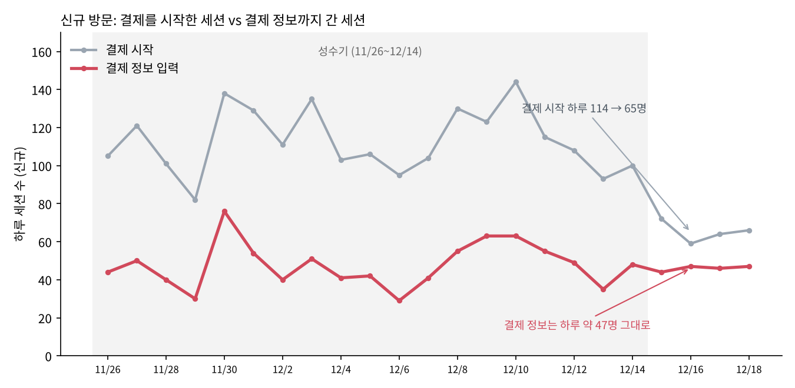

# GA4 이커머스 데이터로 연말 시즌 전후 구매 퍼널을 분석해 이탈 구간을 찾고 개선을 제안한 프로젝트

> 연말 성수기에 처음 온 방문자의 **58%가 결제를 시작한 뒤 결제 정보 입력 전에 이탈**합니다.
> 이탈 패턴을 근거로 최종 금액과 도착 예정일을 미리 보여주는 개선안을 제안하고, 효과를 확인할 A/B 테스트를 설계했습니다.

`BigQuery SQL` `Python (statsmodels)` `Tableau` · 개인 프로젝트 · 2026.11

---

## 1. 어떤 문제를 해결하기 위해

- 현업 요청 가정: "블랙프라이데이 때 방문자가 늘었는데, 성과 좋았던 거죠?"
- 시즌 성과는 좋았음(세션 전환율 1.91%). 시즌이 끝난 1월 일 매출은 **−72%**
- 이 하락이 **계절 요인**인지 **고칠 수 있는 누수**인지 구분하는 것이 목표

## 2. 어떤 역량과 데이터를 활용했고

| 구분 | 내용 |
|---|---|
| 데이터 | GA4 이커머스 공개 샘플(구글 굿즈 스토어), 2020-11-01 ~ 2021-01-31, 이벤트 약 430만 건 → 세션 약 36만 개 |
| 기술 | BigQuery SQL, Python statsmodels |
| 역량 | 요청을 분석 질문으로 바꾸기, 지표 정의와 정합성 검증, KPI 트리·퍼널 분해, 통계 검정, A/B 설계, 해석 재검토 |

## 3. 실제로 어떤 분석 결과가 나왔고

| 발견 | 숫자 |
|---|---|
| 1월 매출 하락은 덜 사고 적게 사서 생김 | 하락 기여: 전환율 51.5%, 구매 세션당 매출 34.1%, 방문 14.4% |
| 전환율 하락은 결제를 시작하기 전에 생김 | 조회 → 결제 시작 18.1% → 9.5% (하락 기여 99%), 결제 이후 단계는 오히려 나음 |
| 하락은 신규 방문에서 큼 → 계절 요인 | 조회 → 결제 시작: 신규 −58% vs 재방문 −28% (p < 0.001) |
| 고칠 수 있는 누수는 성수기 신규의 결제 단계 | 결제 정보 입력까지 신규 42.3% vs 재방문 82.1% |
| 이탈은 기기·국가와 무관 | p = 0.50 / 0.60 |
| 배송 마감 무렵부터 "확인만 하는 결제 시작"이 사라짐 | 신규 결제 시작 하루 114 → 65명, 결제 정보 도달은 약 47명으로 같음 |



## 4. 문제를 어떻게 개선하면 좋겠나

- **해석**: 성수기 신규는 결제 화면에서만 보이는 정보(배송비가 붙은 최종 금액, 도착 예정일)를 확인하러 결제를 시작했다가 떠나는 것으로 보임 (금액·도착일 중 무엇인지는 로그로 구분 불가)
- **개선안**: 장바구니에서 최종 금액(배송비 포함)과 도착 예정일을 미리 표시
- **A/B 설계**: 성수기 신규 장바구니 도달자 대상, 핵심 지표 구매 ÷ 장바구니 도달(기준 14.4%), 19일 실행 시 상대 +21% 이상 효과 검출 가능, 가드레일 주문당 객단가(65.76)
- **평가 기준**: 1월 성과는 12월이 아니라 평소 기준선(세션 전환율 1.0~1.3%)으로 평가

---

## 프로젝트 진행

| 단계 | 한 일 | 문서·코드 |
|---|---|---|
| 1. 도구 선정 | BigQuery SQL·Python 선택, KPI 트리·퍼널·세그먼트 비교 사용 (RFM·코호트는 3개월·쿠키 기준이라 제외), 이벤트 로그를 세션 1행 테이블로 구조화 | [overview §1](docs/project_overview.md#1-도구-선정), sql/11 |
| 2. 주제 및 가설 | 문제 정의 → 가설 7개(맞으면·틀리면 행동 포함) → 지표·판정 기준 정의 → 분석 방법 → 기간 정의 | [overview §2](docs/project_overview.md#2-주제-및-가설-선정), [hypotheses](docs/hypotheses.md) |
| 3. 데이터 수집 | 중복·결측·기록 누락·이상치 19개 항목 점검 (장바구니 기록 공백 발견 포함) | [data_quality_checks](docs/data_quality_checks.md), sql/0x·2x |
| 4. 데이터 분석 | KPI 트리 → 퍼널 → 신규·재방문 → 기기·국가 → 할인 여부 → 주·일별, 민감도 확인 | [overview §4](docs/project_overview.md#4-데이터-분석), sql/3x |
| 5. 해석·가설 검증 | 비율 차이 검정·로지스틱 회귀, 해석 재검토, A/B 기준값·표본 수 | [overview §5](docs/project_overview.md#5-데이터-해석-및-가설-검증), notebooks, sql/4x |

### 가설 검증 결과

| 가설 | 결과 | 행동 |
|---|---|---|
| H1 시즌 방문자의 전환율이 더 낮다 | 기각 (1.91% vs 0.99%) | 시즌 성과 인정, 1월 하락으로 질문 이동 |
| H2 1월 하락은 장바구니 이후에 집중된다 | 기각 (결제 시작 이전 99%) | 하락 주체 확인 |
| H3 하락은 신규에서 더 크다 | 지지 (p < 0.001) | 계절 요인으로 정리 |
| H4 결제 이탈은 모바일·미국 외에서 크다 | 기각 (p = 0.50 / 0.60) | 시기(주·일별)로 범위 이동 |
| H4-b 성수기 신규는 결제 화면 정보를 확인하고 떠난다 | 부분 지지 | 최종 금액·도착 예정일 사전 표시 |
| H6 정보를 미리 보여주면 구매 전환이 오른다 | A/B 설계 | 실험 계획서 |

### 재검토로 바로잡은 해석

처음에는 블프~12/13을 "할인 기간"으로 보고 "할인이 끝나자 결제 이탈이 회복됐다"고 해석했습니다. 할인 근거를 데이터로 확인하자 할인 프로모션·가격 인하가 없었고, 일별로 분자와 분모를 나눠 보니 결제 정보까지 가는 사람 수는 그대로이고 결제를 시작하는 사람만 줄어 있었습니다. "회복"은 분모 감소에 따른 착시였고, 해석과 개선안, A/B 기준 기간을 모두 고쳤습니다. 과정은 [design_notes §3](docs/design_notes.md#3-h4-b-재검토-할인-기간-가정-폐기와-성수기-재정의).

---

## 저장소 구조

```
sql/                       번호 순서대로 실행 (각 파일 맨 위에 [목적] [결과 요약] [판단] [참고사항])
  0x_explore               데이터 파악 (이벤트, 구매 중복, 일별 추이)
  1x_build                 세션 테이블 생성·검증
  2x_quality               정합성 확인 (단계 건너뜀, 신규 정의, 매출 계산, 결측, 일별 기록 상태)
  3x_analysis              퍼널·신규/재방문·민감도·기기/국가·주/일별·KPI 트리·할인 확인
  4x_abtest                A/B 기준값, 가드레일 기준
notebooks/
  p1_stat_tests.ipynb      비율 차이 검정, 로지스틱 회귀, 표본 수·가드레일 계산, 문서 숫자 재계산
docs/
  project_overview.md      프로젝트 전체 정리
  hypotheses.md            가설별 근거·판정 기준·결과·행동 계획
  data_quality_checks.md   정합성 체크표 19개 항목
  design_notes.md          판단을 바꾼 지점과 이유
images/                    README 그래프
```

**핵심 쿼리**: 11(세션 테이블) · 30(퍼널) · 31(신규 vs 재방문) · 39(일별 분자·분모) · 40(A/B 기준값)

**실행**: BigQuery 샌드박스에서 `10` → `11`을 먼저 실행해 세션 테이블을 만든 뒤 나머지를 실행 (프로젝트 ID는 본인 것으로 변경). 노트북은 SQL 결과 숫자만 사용해 원본 데이터 없이 실행 가능.

---

## 한계

- 익명화 샘플이라 주문 번호·쿠폰·배송비 등 일부 값이 가려져 있음
- 사용자 ID가 쿠키 기준이라 기기를 바꾼 고객은 신규로 집계됨
- 전년도 데이터가 없어 계절 요인을 직접 분리할 수 없음
- 장바구니 기록이 11/25까지 불안정해 장바구니가 들어가는 단계의 세부 배분은 다소 불확실
- 결제 화면 안에서 금액 때문인지 도착일 때문인지 로그로 구분할 수 없음 → A/B로 검증

## 다음 단계

실험 계획서 · Tableau 대시보드 · 요약 보고서
