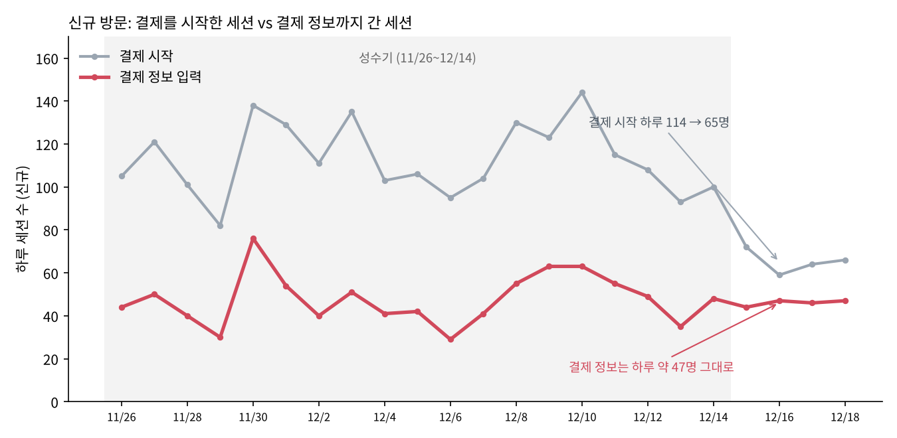

# P1. 연말 시즌 전후 구매 퍼널 분석: 성수기 신규 방문자의 결제 단계 이탈

GA4 이커머스 데이터로 연말 시즌 전후 구매 퍼널을 분석해 이탈 구간을 찾고 개선을 제안한 프로젝트

---

## 1. 어떤 문제를 해결하기 위해

- 현업 요청 가정: "블랙프라이데이 때 방문자가 늘었는데, 성과 좋았던 거죠?"
- 시즌(11/23~12/18) 성과는 좋았음: 세션 전환율 1.91%, 비시즌의 약 2배
- 시즌이 끝난 1월(비시즌) 일 매출은 시즌 대비 **−72%**
- 이 하락이 **계절 요인**인지 **고칠 수 있는 누수**인지 구분해, 고칠 곳에 집중하고 1월 성과를 맞는 기준으로 평가하는 것이 목표

## 2. 어떤 역량과 데이터를 활용했고

| 구분 | 내용 |
|---|---|
| 데이터 | GA4 이커머스 공개 샘플(구글 굿즈 스토어), 2020-11-01 ~ 2021-01-31, 이벤트 약 430만 건 → 세션 약 36만 개 |
| 기술 | BigQuery SQL(세션 테이블 구축·집계), Python statsmodels(비율 차이 검정·로지스틱 회귀·검정력 분석) |
| 역량 | 요청을 분석 질문으로 바꾸기, 지표 정의와 데이터 정합성 검증, KPI 트리·퍼널 분해, 통계 검정, A/B 테스트 설계, 해석 재검토 |

## 3. 실제로 어떤 분석 결과가 나왔고

| 발견 | 숫자 |
|---|---|
| 1월 매출 하락은 덜 사고(전환율) 적게 사서(구매 세션당 매출) 생김 | 하락 기여: 전환율 51.5%, 구매 세션당 매출 34.1%, 방문 14.4% |
| 전환율 하락은 결제를 시작하기 전에 생김 | 조회 → 결제 시작 18.1% → 9.5%, 하락 기여 99%. 결제 이후 단계는 하락을 상쇄 |
| 하락은 신규 방문에서 큼 → 계절 요인 | 조회 → 결제 시작: 신규 −58% vs 재방문 −28% (상호작용 p < 0.001) |
| 고칠 수 있는 누수는 성수기 신규의 결제 단계 | 결제 시작 후 결제 정보 입력까지 신규 42.3% vs 재방문 82.1% (신규 58% 이탈) |
| 이탈은 기기·국가와 무관 | 모바일 vs 데스크톱 p = 0.50, 미국 외 vs 미국 p = 0.60 |
| 배송 마감 무렵부터 "확인만 하는 결제 시작"이 사라짐 | 신규 결제 시작 하루 114 → 65명, 결제 정보 도달은 약 47명으로 같음 |

## 4. 문제를 어떻게 개선하면 좋겠나

- **해석**: 성수기 신규는 결제 화면에서만 보이는 정보(배송비가 붙은 최종 금액, 도착 예정일)를 확인하러 결제를 시작했다가 떠나는 것으로 보임. 금액 때문인지 도착일 때문인지는 로그로 구분할 수 없음
- **개선안**: 장바구니에서 최종 금액(배송비 포함)과 도착 예정일을 미리 표시
- **검증**: A/B 테스트 설계 (실험 계획서 `docs/experiment_plan.md`, 작성 예정)

| 항목 | 값 |
|---|---|
| 대상 | 성수기(11/26~12/14) 신규 중 장바구니 도달자, 사용자 단위 50:50 배정 |
| 핵심 지표 | 구매 ÷ 장바구니 도달, 기준 14.4% |
| 진단 지표 | 결제 정보 ÷ 결제 시작, 기준 42.3% |
| 가드레일 | 주문당 객단가 65.76, 장바구니 도달자당 매출 |
| 검출 가능 효과 | 19일 실행 시 +3.0%p (상대 +21%), α 0.05, 검정력 0.8 |

- **평가 기준 제안**: 1월 성과는 12월이 아니라 평소 기준선(세션 전환율 1.0~1.3%)과 비교

---

# 프로젝트 진행

## 1. 도구 선정

### 기술 스택

| 도구 | 선택 이유 | 사용한 곳 |
|---|---|---|
| BigQuery SQL | 원본이 BigQuery 공개 데이터이고 430만 행 로그 집계에 적합. 샌드박스로 무료 사용 | 세션 테이블, 퍼널·KPI 집계, 정합성 확인 (sql/01~41) |
| Python (statsmodels) | SQL로 어려운 검정·회귀·표본 수 계산, 문서 숫자 재계산 | notebooks/p1_stat_tests.ipynb |
| Tableau (예정) | 대시보드 공유 | CSV 연결 |

### 분석 프레임워크

| 프레임워크 | 사용 | 이유 |
|---|---|---|
| KPI 트리 | O | 매출 하락을 방문 × 전환율 × 구매 세션당 매출로 나눠 어디서 왔는지 확인 |
| 퍼널 | O | 전환율 하락이 구매까지 어느 단계에서 생겼는지 확인 |
| 세그먼트 비교 | O | 신규·재방문, 기기·국가, 주·일별로 나눠 계절 요인과 누수를 구분 |
| AARRR | 범위 설명 | 전환(Activation → Revenue) 구간을 다룸 |
| RFM | X | 3개월 데이터이고 사용자 ID가 쿠키 기준이라 재구매 이력을 쌓기 어려움 |
| 코호트 | X | 같은 이유로 장기 리텐션 추적에 부적합 (다른 프로젝트에서 다룸) |

### 데이터 구조화

원본은 이벤트 1건이 1행이고, 상세 값은 `event_params` 안에 중첩돼 있습니다. 이를 **세션(방문 1회) = 1행** 테이블로 바꿨습니다(sql/11).

| 컬럼 | 내용 |
|---|---|
| session_key | 사용자 ID + 세션 ID (세션 ID는 방문 시작 시각이라 다른 사용자와 겹칠 수 있어 함께 사용) |
| session_date | 세션 시작일 (기간 배정 기준) |
| view_item ~ purchase | 단계별 도달 여부 (1 / 0) |
| revenue, tx_count | 세션 매출(주문 단위 중복 제거 후 합계), 주문 수 |
| session_number | 방문 순서 (`ga_session_number`, 1 = 신규) |
| has_first_visit | 첫 방문 이벤트 유무 (신규 정의 교차 확인용) |
| device, country | 세그먼트 |
| period | pre / season / holiday / off |

세션 단위를 택한 이유

- 사용자 단위로 3개월을 합치면 "11월에 보고 1월에 산" 흐름이 섞여 기간 비교가 안 됨 (sql/01)
- 이벤트 단위는 중복 기록이 그대로 남음 (sql/02)
- 테이블로 저장해 모든 분석이 같은 정의를 쓰고, 원본 반복 조회 비용(쿼리당 약 1GB)을 줄임

## 2. 주제 및 가설 선정

### (1) 문제 정의

| 현상 | 문제 | 해결되면 |
|---|---|---|
| 시즌 세션 전환율 1.91%, 1월 일 매출 −72% | 하락이 계절 요인인지 고칠 수 있는 누수인지 모름 | 고칠 구간에 자원을 쓰고, 1월 성과를 맞는 기준으로 평가 |

가설이 기각될 때마다 질문을 좁혔습니다.

| 차수 | 질문 | 계기 |
|---|---|---|
| 1차 | 시즌 성과가 좋았나? | 현업 요청 |
| 2차 | 1월 하락은 어느 단계에서, 누구에게서 생겼나? | H1 기각 (시즌이 더 좋았음) |
| 3차 | 고칠 수 있는 누수는 어디인가? | H2 기각, H3 지지 (1월 하락은 계절 요인) |
| 4차 | 성수기 신규의 결제 단계 이탈을 어떻게 줄이고 검증하나? | H4 기각, H4-b 부분 지지 |

### (2) 가설 설정

결과를 보기 전에 맞으면·틀리면 할 행동을 정했습니다. 근거와 판정 과정은 `docs/hypotheses.md`.

| 가설 | 맞으면 | 틀리면 |
|---|---|---|
| H1 시즌 방문자의 세션 전환율은 비시즌보다 낮다 | 시즌 유입 품질 개선 | 시즌 성과 인정, 비시즌 하락으로 질문 이동 |
| H2 비시즌 전환율 하락은 장바구니 이후 단계에 집중된다 | 비시즌 결제 과정 개선 | 계절 요인으로 정리, 결제 누수는 다른 시기·집단에서 찾기 |
| H2-s 장바구니 없는 구매는 이전 방문에서 담았기 때문이다 | 엄격 기준 퍼널 유지 | 장바구니 단계를 "구매 의도"로 재정의 |
| H3 비시즌 구매 의도 하락은 신규에서 더 크다 | 계절 요인(신규 수요 감소)으로 정리 | 전반적 수요 감소로 정리 |
| H4 시즌 신규의 결제 이탈은 모바일·미국 외에서 더 크다 | 해당 그룹 맞춤 개선 | 시즌 신규 전체 대상, 시기 요인 확인 |
| H4-b 성수기 신규는 결제 화면에서만 보이는 정보를 확인하고 떠난다 | 그 정보를 장바구니에서 미리 표시 | 결제 화면 사용성 점검 |
| H6 최종 금액·도착 예정일을 미리 보여주면 구매 전환이 오른다 | 성수기에 개선안 적용 | 다음 후보(입력 간소화 등) 시험 |

### (3) 지표 정의

| 지표 | 정의 | 용도 |
|---|---|---|
| 세션 전환율 | 구매 세션 ÷ 전체 세션 | 기간 성과 비교 |
| 단계 전환율 | 다음 단계 도달 세션 ÷ 이전 단계 도달 세션 | 이탈 구간 찾기 |
| 하락 기여도 | ln(비시즌율 ÷ 시즌율) ÷ 전체 합계 | 곱셈 구조의 하락을 순서와 무관하게 나누기 |
| 구매 세션당 매출 | 매출 ÷ 구매 세션 | KPI 트리 (전환율의 분자와 단위를 맞춤) |
| 주문당 객단가 | 매출 ÷ 주문 | A/B 가드레일 (한 번 주문할 때의 금액) |

하락 기여도에 로그를 쓴 이유: 일 매출 = 세션 × 전환율 × 구매 세션당 매출이라 변화율을 더하면 합이 맞지 않고(−17% −48% −35% ≠ −72%), 하나씩 바꿔 계산하면 순서에 따라 결과가 달라짐(구매 세션당 매출 기여가 21% ~ 49%). 로그는 곱셈을 덧셈으로 바꿔 순서와 상관없이 합계 100%로 나눔.

판정 기준

| 기준 | 값 | 근거 |
|---|---|---|
| 의미 있는 차이 | p < 0.05 그리고 상대 차이 10% 이상 | 세션이 10만 개 이상이라 작은 차이도 유의하게 나옴. 화면·정책을 바꿀 만한 크기인지 함께 확인 |
| 주된 원인 | 하락 설명 비율 70% 이상 | 대부분(3분의 2 이상)을 설명해야 주된 원인으로 볼 수 있음 |
| 퍼널 정의 재검토 | 단계 건너뛴 구매 10% 이상 | 구매의 10분의 1 이상이 이탈로 잘못 분류되면 단계 전환율 해석이 흔들림 |
| 세그먼트 판정 | 표본 100세션 이상 | 그보다 적으면 비율이 불안정 (태블릿 제외) |
| 결측 처리 | 최악의 경우를 가정해도 결론이 같으면 유지 | 국가 값 없음 0.8%로 확인 |

### (4) 분석 방법

- 비교 기간: 시즌 11/23~12/18 vs 비시즌 1/5~1/31
- 퍼널: 최대 도달 기준(뒤 단계 기록이 있으면 앞 단계도 통과)을 메인, 엄격 기준(앞 단계를 모두 거쳐야 통과)으로 민감도 확인
- 분해 순서: KPI 트리 → 퍼널 단계 → 신규·재방문 → 기기·국가 → 주·일별
- 검정: 두 비율 차이 z-검정과 신뢰구간, 신규·재방문 차이는 로지스틱 회귀 상호작용 항
- 민감도 확인: 퍼널 방식, 비교 기준(시즌 전), 기간 경계를 바꿔도 결론이 같은지

### (5) 데이터 수집 방법

| 필요한 것 | 이 데이터에서 |
|---|---|
| 시즌과 비시즌이 모두 있는 기간 | 11/1~1/31 공개 범위 전체 (시즌 전·시즌·연휴·비시즌 포함) |
| 방문 단위 행동 | 사용자 ID, 세션 ID, 방문 순서 |
| 퍼널 단계 | 조회·장바구니·결제 시작·결제 정보·구매 이벤트 |
| 세그먼트 | 기기, 국가 |
| 매출 | 구매 금액, 주문 번호 |

기간 정의

| 기간 | 날짜 | 근거 |
|---|---|---|
| 시즌 전 | 11/1~11/22 | 장바구니 기록 공백이 커서 민감도 확인에만 사용 |
| 시즌 | 11/23~12/18 | 구매 세션 급증(11/22 29건 → 11/24 97건)·급감(12/18 79건 → 12/20 19건) (sql/03) |
| 연휴 (제외) | 12/19~1/4 | 배송 마감 이후라 평소 행동이 아님 (전환율 0.84%) |
| 비시즌 | 1/5~1/31 | 연휴 이후 |
| 성수기 (A/B용) | 11/26~12/14 (19일) | 시작: 장바구니 기록이 하루 전체 정상인 첫날 / 끝: 신규 결제 시작이 줄기 시작한 12/15의 전날 (sql/29, 39) |

시즌은 KPI 트리·퍼널의 기간 비교에, 성수기는 A/B 대상과 기준값에 씁니다.

## 3. 데이터 수집

BigQuery 공개 데이터를 직접 조회했습니다. 이벤트 로그라 전처리는 빈칸 채우기보다 **중복 기록, 기록 누락, 정의 설계**가 중심이었습니다. 전체 19개 항목은 `docs/data_quality_checks.md`.

| 유형 | 문제 | 처리 |
|---|---|---|
| 중복 | 같은 주문 중복 기록 335건 | 구매 = 구매 이벤트가 있었던 세션, 매출은 세션 × 주문 번호 단위로 중복 제거 |
| 중복 | 매출 계산 방식에 따른 차이 | 주문 단위 대비 MAX −7.4%, SUM +4.9% → 주문 단위 채택 |
| 결측 | 주문 번호 없음 906건(16%) | 삭제하지 않고 같은 방문 안에서 1건으로 묶음. 실제 매출은 MAX(하한) ~ SUM(상한) 사이 |
| 결측 | 세션 ID 0건, 국가 0.8%, 기기 0건 | 국가 값 없음은 모두 이탈·모두 전환을 가정해도 결론 같아 유지 |
| 결측 | 쿠폰·배송비 기록 없음 | 할인·배송비 영향은 확인 불가로 한계에 기록 |
| 기록 오류 | 장바구니 기록: 11/1~15 꺼짐, 11/16~19 일시 기록, 11/20~24 꺼짐, 11/25 부분, 11/26부터 정상 | 장바구니가 들어가는 분석은 11/26 이후 기준으로 확인 |
| 기록 오류 | 단계 건너뛴 구매 25~31% | 최대 도달 기준 퍼널, 장바구니 단계를 "구매 의도(장바구니 또는 바로 결제)"로 재정의 |
| 기록 오류 | 배송 정보 이벤트가 결제 시작과 99.98% 동시 기록 | 퍼널에서 제외 |
| 이상치 | 주문 금액 치우침 (평균 66, 중앙값 45) | 실제 매출이라 제거하지 않음. A/B 분석 시 상위 1% 제외 평균·중앙값 병행 |
| 정의 | 신규 정의 | 방문 순서 = 1 (첫 방문 이벤트와 98.4% 일치, 모순 0건) |

장바구니 기록 공백을 행동이 아닌 추적 누락으로 본 근거

- 꺼진 날에는 조회 세션이 1,000개 넘어도 장바구니 세션이 0개
- 하룻밤 사이에 켜지고 꺼짐 (11/16 10.9% → 11/17 62.5% → 11/20 0.6%)
- 같은 날 조회·결제 시작·결제 정보·구매는 정상 기록
- 정상 기간에도 결제 시작의 21~28%는 장바구니 기록이 없음 = 바로 결제(실제 행동)

## 4. 데이터 분석

### KPI 트리: 매출 하락은 어디서 (sql/36)

| KPI | 시즌 | 비시즌 | 변화 | 하락 기여 |
|---|---:|---:|---:|---:|
| 일 매출 | 7,118 | 1,982 | −72% | |
| 일 세션 | 4,774 | 3,970 | −17% | 14.4% |
| 세션 전환율 | 1.91% | 0.99% | −48% | 51.5% |
| 구매 세션당 매출 | 78.1 | 50.5 | −35% | 34.1% |

와서 덜 사는 것(전환율)이 가장 큰 원인. 방문 유입을 늘려도 하락의 14%만 다룸.

### 퍼널: 전환율 하락은 어느 단계에서 (sql/30)

장바구니 기록 차이에 영향받지 않도록 조회 → 결제 시작을 한 단계로 묶어 봤습니다.

| 단계 | 시즌 | 비시즌 | 하락 기여 |
|---|---:|---:|---:|
| 방문 → 조회 | 22.9% | 20.1% | 20% |
| 조회 → 결제 시작 | 18.1% | 9.5% | **99%** |
| 결제 시작 → 결제 정보 | 62.6% | 72.7% | −23% |
| 결제 정보 → 구매 | 73.5% | 71.5% | 4% |

- 조회 → 결제 시작만 비시즌 값으로 바꿔도 세션 전환율이 1.91% → 1.00%로 실제 비시즌(0.99%)과 거의 같아짐
- 결제를 시작한 뒤의 단계는 비시즌이 오히려 나음 → 1월 하락은 결제 과정 문제가 아님
- 장바구니 기준으로 나누면 조회 → 구매 의도 67%, 구매 의도 → 결제 시작 32%. 이 배분은 장바구니 기록 차이로 다소 불확실

### 신규 vs 재방문: 누구에게서 (sql/31)

| 지표 | 신규 | 재방문 |
|---|---|---|
| 조회 → 결제 시작 (시즌 → 비시즌) | 14.9% → 6.2% (−58%) | 24.2% → 17.3% (−28%) |
| 시즌 결제 시작 → 결제 정보 | **44.8%** | 82.8% |
| 시즌 방문 100번당 구매 | 0.99 | 4.12 |

- 신규의 구매 의도가 재방문보다 크게 줄어듦 → 계절 수요(선물 구매 등)가 끝난 영향으로 추정
- 시즌 신규만 결제 정보 단계에서 절반 이상 이탈 → 30번에서 결제 정보 단계가 비시즌에 더 높았던 이유

### 기기·국가 (sql/34)

시즌 신규의 결제 정보 전환율은 기기·국가 조합 모두 43~47%, 비시즌은 62~68%. 차이를 만드는 것은 기기·국가가 아니라 시즌 여부.

### 할인 여부 확인 (sql/37)

| 확인 | 결과 |
|---|---|
| 프로모션 | 3개월 내내 같은 4개만 노출, 할인·시즌 프로모션 없음 |
| 상품 가격 | 같은 상품의 주별 가격이 정상가 대비 1.02~1.06으로 일정, 시즌 할인 상품 비율 0.3~0.7% |
| 쿠폰·배송비 | 기록 없음 (확인 불가) |

"할인 기간(11/23~12/13)" 가정은 근거가 없어 폐기하고, 데이터로 경계를 정한 성수기(11/26~12/14)로 바꿨습니다.

### 주별·일별: 결제 단계 이탈의 패턴 (sql/35, 39)

| 신규, 하루 평균 | 11/26~12/13 | 12/15~12/18 |
|---|---:|---:|
| 결제 시작 | 114 | 65 |
| 결제 정보 | 48 | 46 |
| 결제 정보 전환율 | 42.0% | 70.5% |

- 주별로 보면 12/14 주 신규 결제 정보 전환율이 64.3%로 오름
- 일별로 나누면 결제 정보까지 가는 사람 수는 그대로이고 결제를 시작하는 사람만 줄어듦 → 비율 상승은 분모 감소에 따른 착시
- 결제 화면을 확인만 하고 떠나던 신규가 12/15부터 들어오지 않음 (12/15는 2020년 미국 우체국 일반 소포 마감일과 겹침)

### 민감도 확인 (sql/30, 32, 33)

| 바꾼 것 | 결과 |
|---|---|
| 퍼널 방식 (엄격 기준) | 기여도 순위 같음 |
| 기간 경계 (시즌 11/27~, 비시즌 1/11~), 장바구니 공백 11/23~25 제외 포함 | 구매 의도 단계 1위 유지 (93.6%) |
| 비교 기준 (시즌 전) | 장바구니 공백으로 단계별 비교 불가, 조회 → 결제 시작 합산으로는 비시즌만 낮음 |

## 5. 데이터 해석 및 가설 검증

| 가설 | 결과 | 행동 |
|---|---|---|
| H1 | 기각 (1.91% vs 0.99%) | 시즌 성과 인정, 1월 하락으로 질문 이동 |
| H2 | 기각 (하락은 결제 시작 이전, 결제 정보 → 구매 p = 0.147) | 결제 과정 대신 하락 주체 확인 |
| H2-s | 기각 (15.8~15.9%만 설명) | 구매 의도로 재정의, 최대 도달 기준 |
| H3 | 지지 (상호작용 오즈비 0.631, p < 0.001) | 1월은 계절 요인 → 평소 기준선으로 평가 |
| H4 | 기각 (p = 0.50 / 0.60) | 시기(주·일별)로 범위 이동 |
| H4-b | 부분 지지 (이탈 패턴 확인, 금액·도착일 구분 불가) | 두 정보를 함께 보여주는 개선안 |
| H6 | A/B 설계 | 실험 계획서 |

### 재검토로 바로잡은 해석

| 처음 해석 | 문제 | 바로잡은 해석 |
|---|---|---|
| 할인 기간 신규가 할인가를 기대했다가 최종 금액을 보고 떠남 | 할인 근거 없음 (sql/37) | 성수기 신규가 결제 화면 정보를 확인하고 떠남 |
| 12/14 주 64.3%로 "할인 후 회복" | 결제 시작 감소에 따른 착시 (sql/39) | 결제 정보 도달 인원은 그대로 |
| 마감 직전 상승 → 도착일 걱정 기각 | 상승이 착시라 근거 무효 | 금액과 도착일 모두 후보 |
| 1월 하락은 장바구니 이전 87% | 장바구니 기록 상태가 시즌·비시즌에 다름 | 조회 → 결제 시작 99% (장바구니 무관) |

### 개선안이 바뀐 과정

| 단계 | 개선안 | 바뀐 이유 |
|---|---|---|
| H4 | 결제 정보 화면 개선 (모바일 입력 간소화, 해외 배송 안내) | 기기·국가 무관. 같은 화면에서 재방문은 82% 통과 → 화면 자체 문제가 아님 |
| H4-b 처음 | 장바구니에 할인·배송비 반영 최종 금액 표시 | 할인 근거 없음 |
| 최종 | 장바구니에 최종 금액(배송비 포함)과 도착 예정일 표시 | 확인하러 들어왔다 떠나는 패턴, 이유는 금액·도착일 중 구분 불가 |

결제 화면 사용성 개선은 버리지 않고, 실험에서 효과가 없을 때 시험할 다음 후보로 둡니다.

### A/B 테스트 설계 요약

| 항목 | 값 | 근거 |
|---|---|---|
| 핵심 지표 | 구매 ÷ 장바구니 도달 14.4% (654 / 4,554) | 개선안이 장바구니에서 작동해 결제 시작 인원이 바뀜 → 결제 시작을 분모로 쓰면 구매가 늘지 않아도 지표가 오름 (sql/39에서 실제로 확인한 착시) |
| 진단 지표 | 결제 정보 ÷ 결제 시작 42.3% | 효과가 결제 단계에서 났는지 해석용 |
| 가드레일 | 주문당 객단가 65.76 | 유의하게 하락하면 보류. 유의 기준 16.7% ≈ 손익분기 17.4% |
| 보조 가드레일 | 장바구니 도달자당 매출 | 객단가 단독으로는 손익분기 수준 하락을 잡을 확률 약 50% |
| 표본·기간 | 하루 240명 × 19일, 그룹당 약 2,280명 | 성수기 전체 |
| 최소 검출 효과 | +3.0%p (14.4% → 17.4%, 상대 +21%) | 기간이 정해져 있어 역산 |
| 조기 중단 | 결제 오류·배정 비율 이상은 즉시, 객단가는 첫 주 이후 −30% | 첫 주 유의 기준 약 28% |
| 측정 범위 | 트리거 세션 안의 구매 | 기준값이 세션 단위라 맞춤 |

## 한계

- 익명화 샘플이라 주문 번호·쿠폰·배송비 등 일부 값이 가려져 있음
- 사용자 ID가 쿠키 기준이라 기기를 바꾼 고객은 신규로 집계됨
- 전년도 데이터가 없어 계절 요인을 직접 분리할 수 없음
- 장바구니 기록이 11/25까지 불안정해 장바구니가 들어가는 단계의 세부 배분은 다소 불확실
- 결제 화면 안에서 금액 때문인지 도착일 때문인지 로그로 구분할 수 없음 → A/B로 검증
- 회사 주문 데이터베이스가 없어 GA4 매출을 실제 결제 매출과 대조할 수 없음
- 방문 급증일(12/8, 1/6)과 1/20 이후 조회 비율 상승의 원인(트래픽 성격)은 확인하지 않음
